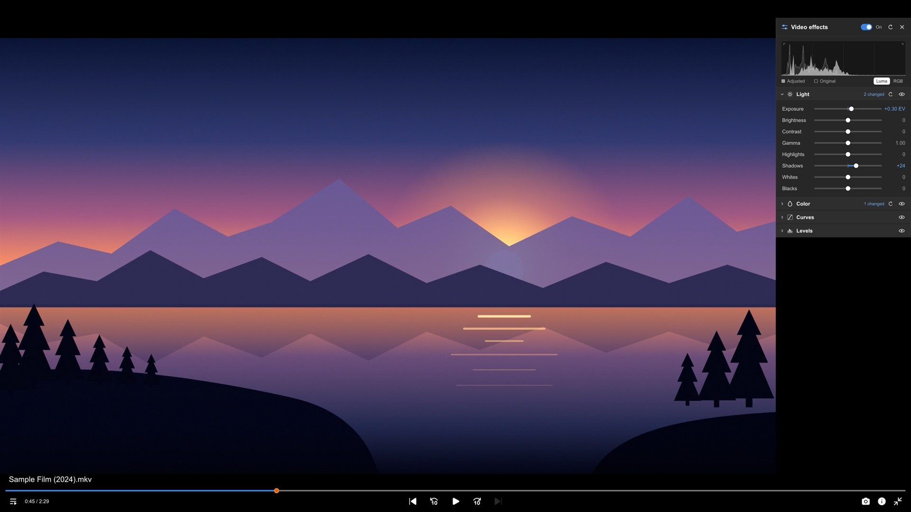
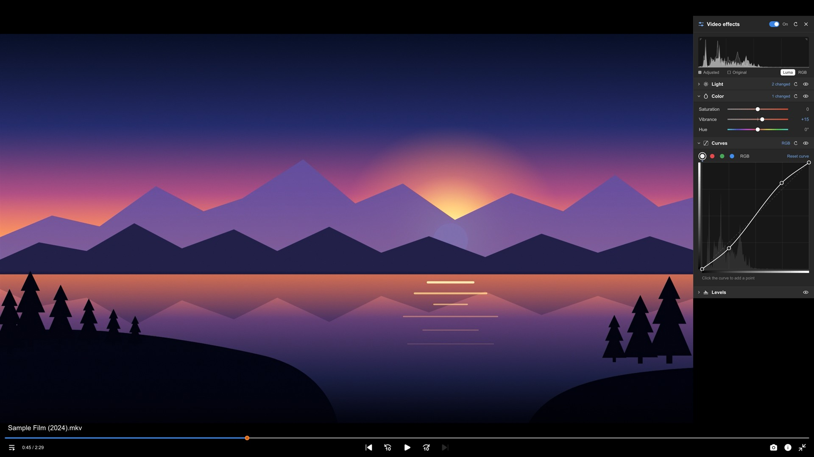
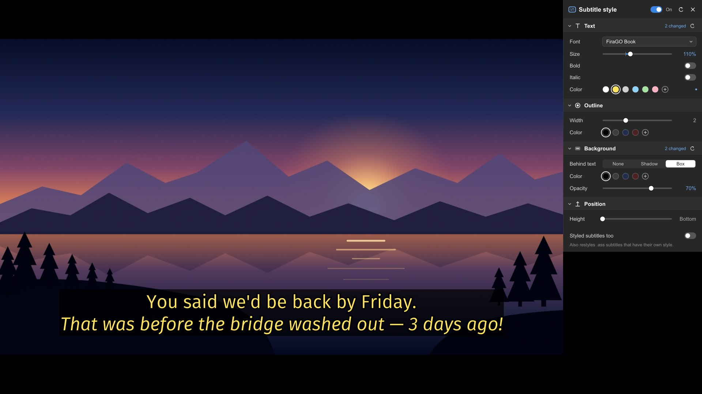
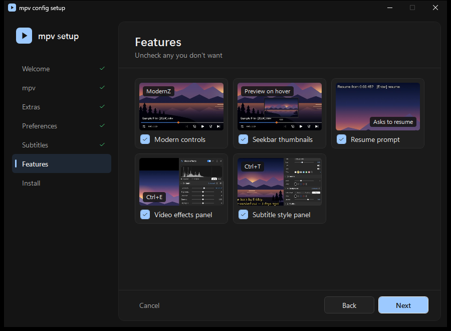
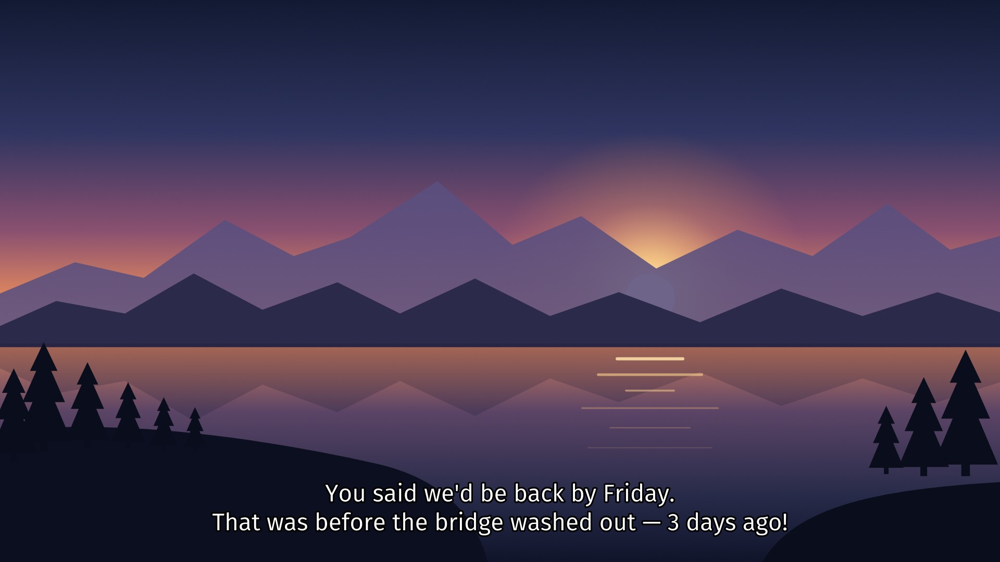

# mpv config

A ready-to-use configuration for the [mpv](https://mpv.io) media player: live panels for video
effects and subtitle style, a trimmed right-click menu, YouTube-style keys, a modern on-screen
controller with seekbar thumbnails, and a few quality-of-life scripts. It comes with a setup
wizard for Windows and an install script for Linux and macOS.



## Features

- **Video effects panel** (<kbd>Ctrl</kbd>+<kbd>E</kbd>, or right-click › Video › Effects…).
  Adjust the picture while it plays:
  - **Light:** exposure, brightness, contrast, gamma, highlights, shadows, whites and blacks.
  - **Color:** saturation, vibrance and hue.
  - **Curves and Levels:** for RGB together or for each channel.

  A live histogram shows the adjusted picture with the original behind it. Changes run on the GPU
  and apply instantly. They carry over from file to file and reset when mpv closes.
- **Subtitle style panel** (<kbd>Ctrl</kbd>+<kbd>T</kbd>, or right-click › Subtitle › Style…): font,
  size, bold and italic, text color, outline, a shadow or a box behind the text, and height. The
  style is kept from one session to the next, and Reset goes back to `mpv.conf`. While the panel is
  open, videos without subtitles show a sample line.
- **Modern controls:** the [ModernZ](https://github.com/Samillion/ModernZ) on-screen controller,
  with seekbar thumbnails from [thumbfast](https://github.com/po5/thumbfast).
- **A shorter right-click menu:** Open, Playlist, Chapters, Video, Audio, Subtitle, Speed, Window,
  View, Profiles and Tools.
- **Open › File…** (<kbd>Ctrl</kbd>+<kbd>O</kbd>) shows the system's file dialog. If you pick
  several files, the first one plays and the rest are queued.
- **Folder playlists:** opening one file queues the rest of its folder (videos with videos, music
  with music).
- **Resume prompt:** a partly watched file offers to resume (<kbd>Enter</kbd>) instead of jumping
  straight to where you left off.
- **Remembered settings:** volume, mute and looping stay as you left them.
- **Subtitles:** FiraGO, or another font picked when installing, with fallback fonts. Each font has
  its own size, so they all come out about the same size on screen.
- **Quality presets:** Ultra, High (the default) or Light (see below). HDR passes through to HDR
  displays and is tone-mapped on SDR displays. <kbd>F1</kbd> toggles the best scalers.
- **Web videos:** with yt-dlp (the installers can add it), YouTube and other site links play
  directly.
- **Updates (Windows):** mpv checks for a new build once a day while it runs. *Tools › Update mpv…*
  installs the new build after testing it, and *Tools › Undo last mpv update* goes back.





## Requirements

- **mpv:**
  - **Custom right-click menu:** this needs a development build newer than the 0.41.0 release.
    On Windows, the setup wizard and the updater install one.
  - **Stable releases (0.41.0 and older):** these have no right-click menu (right-click pauses
    instead). Everything else works.
  - **Linux and macOS:** for the custom menu, use a nightly or git package of mpv.
- **Video effects panel:** needs `vo=gpu-next`, which `mpv.conf` already sets.
- **Platforms:** tested on Windows 11. Linux, BSD and macOS are supported through `install.sh`,
  but not tested on those systems.
- **File dialog on Linux:** needs `zenity` or `kdialog`, so it doesn't work in the Flatpak version
  of mpv.

## Install

### Windows: setup wizard

1. Download this repository (*Code › Download ZIP*) and extract it.
2. Double-click **`Install.cmd`**. If Windows asks whether to run a file from the internet, choose
   *Run*.
3. Go through the wizard and click *Install*.



The wizard lets you choose:

- **Install mpv** if it isn't installed yet. It downloads the latest build, checks it against its
  published checksum and test-plays it first.
- **Web videos:** yt-dlp.
- **Default player:** make mpv the default player for video and audio files.
- **Shortcuts:** Start menu and desktop.
- **"Play with mpv" for folders:** in File Explorer's right-click menu.
- **The daily update check.**
- **Preferences:** the quality preset, and subtitle and audio languages.
- **Subtitle font:** FiraGO, Atkinson Hyperlegible, Segoe UI, Calibri, Verdana or Arial, with a
  preview of each.
- **Features:** ModernZ controls, seekbar thumbnails, the resume prompt, and the video effects and
  subtitle style panels, with a picture of each one.

An existing mpv config is moved to a backup folder next to it (`mpv-backup-<date>`), never
deleted. Everything is set up for your Windows user. Administrator rights are only requested if
mpv lives in a protected folder such as `Program Files`.

**Uninstall:** run **`Uninstall.cmd`**, which the wizard puts next to `mpv.exe`. It offers two
options:
- **Remove just this config:** this also puts back the config you had before.
- **Remove mpv and everything with it.**

**Without the window:**
```
powershell -ExecutionPolicy Bypass -File installer\install.ps1 -Silent -InstallMpv -Fonts -WebVideos -StartMenuShortcut -Preset high
```
See `Get-Help .\installer\install.ps1 -Detailed` for every option. The uninstaller also takes
`-Silent`.

### Linux and macOS: install.sh

```
sh install.sh
```

It asks a few questions and then installs into `~/.config/mpv`, or into the Flatpak or Snap config
folder when that is the mpv it finds. Before installing, it backs up any existing config.

The questions cover:
- the quality preset;
- your subtitle and audio languages;
- which features to include;
- the subtitle font (FiraGO, Atkinson Hyperlegible, or a system font that is installed);
- yt-dlp;
- whether mpv should be the default player.

Without questions, for example:
```
sh install.sh -y --preset ultra --font atkinson
```
`sh install.sh --help` lists every option, and `sh install.sh --uninstall` puts the previous
config back. It doesn't install mpv itself; use your package manager.

### Manual

Copy the contents of the **`config`** folder into mpv's config folder:

| System | Folder |
|---|---|
| Windows | `%APPDATA%\mpv` (or `portable_config` next to `mpv.exe` for a portable mpv) |
| Linux and BSD | `~/.config/mpv` |
| Linux, Flatpak | `~/.var/app/io.mpv.Mpv/config/mpv` |
| Linux, Snap | `~/snap/mpv/current/.config/mpv` |
| macOS | `~/.config/mpv` |

## Quality presets

| Preset | What it does |
|---|---|
| **High** (default) | Accurate rendering, with nothing added that changes the look of the video. Runs well on most PCs. |
| **Ultra** | The most accurate scalers and dithering, plus debanding, motion smoothing (interpolation) and HDR peak detection. Needs a strong graphics card. |
| **Light** | mpv's fastest settings, for older PCs and laptops on battery. |

The preset is the last line of `mpv.conf` (`profile=high`). Debanding can also be switched on and
off any time from right-click › Video › Deband.

## Subtitle font

The installers ask which font to use:

| Font | Size | Where it comes from |
|---|---|---|
| [FiraGO](https://github.com/bBoxType/FiraGO) Book (default) | 37 | free download; the installers add it |
| [Atkinson Hyperlegible](https://fonts.google.com/specimen/Atkinson+Hyperlegible) | 39 | free download; the installers add it |
| Segoe UI, Calibri | 41 | Windows |
| Verdana / Arial | 33 / 34 | Windows |
| Noto Sans, DejaVu Sans, Liberation Sans, Cantarell | 36, 33, 34, 38 | common on Linux |
| Helvetica Neue, Avenir Next, Lucida Grande | 34, 35, 34 | macOS |

The sizes make each font about as wide as the others: exact for the Windows fonts, approximate for
the Linux and macOS ones.

If the chosen font isn't installed, subtitles fall back to Segoe UI Semilight (Windows), then
Erewhon if installed, then the system's default font. To change this, edit `sub-font=` in
`mpv.conf`:
- each font can have its own size and weight in brackets, for example `FiraGO Book (37 regular)`;
- font files you put in the config's `fonts` folder count as installed;
- styled ASS/SSA subtitles keep their own fonts.

The subtitle style panel switches between the installed fonts from this list at any time.



## Keys

| Key | Action |
|---|---|
| <kbd>Space</kbd> / <kbd>K</kbd> | Play / pause |
| <kbd>J</kbd> / <kbd>L</kbd> | Back / forward 10 seconds |
| <kbd>←</kbd> / <kbd>→</kbd> | Back / forward 5 seconds |
| <kbd>0</kbd>–<kbd>9</kbd> | Jump to 0–90% |
| <kbd>,</kbd> / <kbd>.</kbd> | Previous / next frame |
| <kbd>&lt;</kbd> / <kbd>&gt;</kbd> | Slower / faster (0.25×) |
| <kbd>Backspace</kbd> | Normal speed |
| <kbd>↑</kbd> / <kbd>↓</kbd> | Volume up / down |
| <kbd>M</kbd> | Mute |
| <kbd>F</kbd> / <kbd>Esc</kbd> | Fullscreen / leave fullscreen |
| <kbd>C</kbd> | Subtitles on / off |
| <kbd>F1</kbd> | Best scalers on / off |
| <kbd>Ctrl</kbd>+<kbd>E</kbd> | Video effects panel |
| <kbd>Ctrl</kbd>+<kbd>T</kbd> | Subtitle style panel |
| <kbd>Ctrl</kbd>+<kbd>O</kbd> | Open files |
| Right-click | Menu |

Everything else uses mpv's default keys.

### In the panels

- **Sliders:** drag one, or click its value to type a number. Double-click resets it.
- **Curves:** click a curve to add a point, and drag a point off the graph to remove it.
- **Colors:** click a dot, or <kbd>+</kbd> to type a color such as `#FFE45C`.
- **Sections:** each one has its own reset button. The switch at the top turns all effects, or the
  whole subtitle style, off and on to compare.
- **Closing:** <kbd>Esc</kbd> closes the panel. Only one panel is open at a time.

## Customizing

- **`config/mpv.conf`:** player settings, each with a comment.
- **`config/script-opts/*.conf`:** options for each script, such as the panels' width and accent
  color, the update check, the yt-dlp updates, and ModernZ's layout.
- **Scripted control of the panels:** `script-message-to video_effects ...` and
  `script-message-to sub_style ...`. The commands are listed at the top of
  `config/scripts/video-effects/main.lua` and `config/scripts/sub-style.lua`.
- **`config/script-modules/kit/`:** code the scripts share: the panel, font lookup and saved files.

## Updates and network use

- **mpv (Windows):** once a day, while mpv is open, `scripts/updater.lua` asks the GitHub API
  (api.github.com) whether a newer build is out, and shows a notice if so. Turn this off with
  `check=no` in `script-opts/updater.conf`.

  *Tools › Update mpv…* runs `tools/mpv-update.ps1`. It:
  - downloads the latest build from
    [zhongfly/mpv-winbuild](https://github.com/zhongfly/mpv-winbuild), a community build service
    rather than the mpv project itself (the source can be changed in `script-opts/updater.conf`);
  - checks the download against the SHA-256 that GitHub publishes for it. That catches corrupted
    downloads; it can't vouch for the build service itself. Builds without a published checksum
    are refused unless you add `-Force`;
  - unpacks the build with Windows' built-in `tar`;
  - test-plays it with your config before installing it;
  - keeps the previous version for *Undo last mpv update*.

  It asks for administrator rights only when mpv is in a protected folder. You can also run
  `tools\update-mpv.cmd` directly. If it can't find mpv, add `-MpvDir "<the folder with mpv.exe>"`.
- **yt-dlp:** if the installer put one in the config folder, `scripts/ytdlp-update.lua` runs
  `yt-dlp -U` at most once a day. Turn this off with `update=no` in
  `script-opts/ytdlp_update.conf`.
- **Background services:** none are installed. All checks run only while mpv is open.

## Where personal data goes

Resume positions, remembered volume and the subtitle style are saved in mpv's state folder, not in
the config: `%LOCALAPPDATA%\mpv` on Windows, `~/.local/state/mpv` on Linux, and the config folder
on macOS. A portable mpv keeps them inside `portable_config`, and `.gitignore` excludes them.

## Credits and licences

- [ModernZ](https://github.com/Samillion/ModernZ):
  - `config/scripts/modernz.lua` is a modified copy; its header lists the changes.
  - `config/fonts/modernz-icons.ttf` is ModernZ's icon font. Its icons come from Google's Material
    Symbols (Apache-2.0) and Microsoft's Fluent System Icons (MIT).
  - Both files are under the [GNU LGPL 2.1](https://github.com/Samillion/ModernZ/blob/main/LICENSE).
- [thumbfast](https://github.com/po5/thumbfast): `config/scripts/thumbfast.lua`, under the
  [Mozilla Public License 2.0](https://github.com/po5/thumbfast/blob/master/LICENSE).
- [mpv](https://github.com/mpv-player/mpv): `config/menu.conf` is adapted from mpv's default menu
  (`etc/menu.conf`), under mpv's licence (GNU LGPL 2.1 or later).
- [FiraGO](https://github.com/bBoxType/FiraGO) and
  [Atkinson Hyperlegible](https://fonts.google.com/specimen/Atkinson+Hyperlegible) (SIL Open Font
  License): neither is included; the installers download the one you pick from its repository.
- Everything else, including the screenshots, is under the MIT licence; see [LICENSE](LICENSE).
